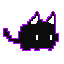
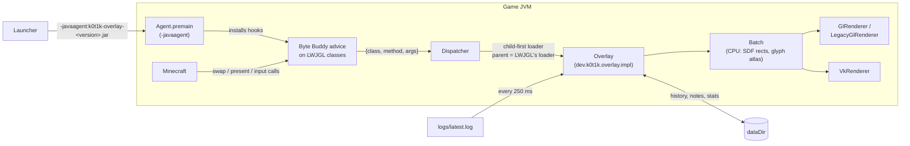

<div align="center">
  
  <h1>_k0t1k overlay</h1>
  <hr>
  <p><b>An in-game overlay for Minecraft Java in one jar: any loader, OpenGL or Vulkan, Minecraft 1.8 to 26.3+</b></p>

  <p>
    
    
    
    
    
  </p>
  <p>
    <a href="https://github.com/hhhhhffd/_k0t1k-overlay/releases/latest"></a>
    <a href="https://github.com/hhhhhffd/_k0t1k-overlay/releases"></a>
    <a href="LICENSE"></a>
  </p>
  <p>
    <a href="https://github.com/hhhhhffd/_k0t1k-overlay/releases/latest">Download</a> ·
    <a href="https://hhhhhffd.github.io/_k0t1k">Launcher</a> ·
    <a href="#architecture">Architecture</a> ·
    <a href="#build">Build</a> ·
    <a href="INTEGRATION.md">Integration</a>
  </p>
</div>

## Summary

An overlay for Minecraft Java in the spirit of the Steam overlay. It is a Java agent, not a mod, so one
jar works on vanilla, Fabric, Forge and NeoForge, with OpenGL or Vulkan (Minecraft's own Vulkan backend
or VulkanMod), on LWJGL 2 (Minecraft 1.8 to 1.12.2), GLFW or SDL3 (Minecraft 26.3+).

The agent hooks LWJGL with Byte Buddy and never touches Minecraft classes. It draws over the finished
frame and takes input before the game sees it. It ships with the
[_k0t1k launcher](https://github.com/hhhhhffd/_k0t1k) as a signed plugin, but any launcher can add it with `-javaagent`.

Press **Shift+Tab** in game to open it, and **Shift+Tab** or **Esc** to close it.

## Features

| Tab / feature | What it does |
|---|---|
| **Chat** | The whole chat history across sessions, servers and instances, with full-text search and filters: mentions, private messages, one player's messages. Click a message to copy it. Messages that mention the player's name show a toast. |
| **Notes** | Notes that persist on disk and save automatically. |
| **Tools** | Overworld ↔ Nether coordinates (with "my position"), stacks and shulker boxes, timers and alarms that survive a restart, the latest screenshots. Each F2 screenshot shows a toast with the instance and position. |
| **Mods** | The instance's mods with a search and what each one does (from the mod's metadata), with links to Modrinth and the mod's homepage. |
| **Profile** | Lifetime stats (play time, sessions, deaths, advancements, screenshots, crashes) and the launcher's achievements on top of them. |
| **Performance** | FPS, frame time, 1% low, a frame time graph, heap, GC and the game's CPU load, plus an optional HUD in a corner of the screen. |
| **Browser** | A real Chromium (JCEF, off-screen rendering) in its own tab: back, forward, reload, an address bar that also searches, quick links (Minecraft Wiki, Modrinth, CurseForge, YouTube). |
| **Replay** | The last 30 seconds kept in memory; **Shift+F2** or the button in Tools saves them as a GIF or a video. |
| **Music** | What the system plays (Spotify, a browser tab, any player) with previous, play/pause and next, and a toast when a new track starts. |
| **Crash window** | After a crash, shows the reason and the report and uploads them to mclo.gs only when the player clicks "Send to support". |
| **Cat** | The launcher's cat sits in a corner and reacts to deaths, advancements, a five minute AFK, timers, screenshots and achievements with a speech bubble (can be turned off in Profile). |

The player's position, dimension and health are read by reflection on `net.minecraft` classes, so they
only work where the game runs with Mojang names: Minecraft 26.1+ and NeoForge. Elsewhere the position
button is hidden and deaths are not counted. Advancements are read from the chat.

<details>
<summary>Feature details: browser, replay, music, crash window</summary>

- **Browser.** Mouse, wheel and keyboard go to the page; logins and cookies persist in
  `<dataDir>/browser/profile`. Chromium is about 170 MB, so it is not in the agent: the first time the
  player clicks "Download the browser", `Browser` fetches `me.friwi:jcef-api` and the platform's
  `jcef-natives-*` (jcefmaven's builds) from Maven Central, checks each against the SHA-256 pinned in
  the code and unpacks them into `<dataDir>/browser`. The bridge (`src/cef`: `OverlayBrowser`, a
  `CefBrowser_N` that keeps its pixels instead of painting into AWT, and `CefEngine`) ships inside the
  agent as `cef-bridge.jar` and loads next to JCEF in a class loader of its own. Windows and Linux on
  x64; the page is drawn by the OpenGL renderer only. CEF needs `--no-first-run` off screen: its EULA
  dialog would otherwise end the browser process with exit code 28.
- **Replay.** Frames are kept as JPEG (about 1 MB a second) and saved to `<gameDir>/replays` as a GIF
  or a video (MP4 when `ffmpeg` is on PATH, otherwise a Motion-JPEG AVI). Frames are scaled down on the
  GPU and read back through pixel buffers with fences, so the game never waits for them. OpenGL only.
- **Music.** Windows uses the system media controls through a PowerShell child (`media.ps1`), Linux
  uses `playerctl`.
- **Crash window.** When the game exits after writing a crash report, the shutdown hook writes what
  only the live JVM knows (a dump of every thread, uncaught exceptions, the overlay's notes on the
  session) to `<dataDir>/crashes/` and starts `dev.k0t1k.overlay.CrashDialog` in a JVM of its own. After
  the upload it opens the support Discord with the link copied.

</details>

## Technical Stack

| Group | Technology | Notes |
|---|---|---|
| Core | Java, compiled with `--release 8` | Runs on Java 8 to 25; built with a JDK 21 toolchain |
| Core | Byte Buddy 1.18.16 | Shaded and relocated to `dev.k0t1k.overlay.shadow.bytebuddy`, so it cannot clash with mods |
| Graphics | LWJGL 3.1.6 (main), 3.3.1 (Vulkan), 3.4.3 (SDL), 2.9.3 (LWJGL 2) | `compileOnly`: the game supplies LWJGL |
| Graphics | GLSL → SPIR-V | `src/main/shaders`, compiled with `glslc` and committed |
| Text | stb_truetype (LWJGL 3), java.awt (LWJGL 2) | Font: Inter, SIL OFL 1.1 |
| Browser | JCEF (jcefmaven) | Downloaded at run time, not bundled |
| Build | Gradle 9.7.1, Shadow 9.6.1 | One fat jar for every OS, CPU, loader and version; no natives inside |

## Architecture



Every hooked method calls one dispatcher with `{class, method, arguments}`. Before the call, the
dispatcher can replace the arguments or skip the call. After the call, it can replace the return value.

| Hook | Purpose |
|---|---|
| `glfwSwapBuffers`, `SDL_GL_SwapWindow` | OpenGL: draws the overlay over the finished frame |
| `vkQueuePresentKHR` | Vulkan: draws into the swapchain image right before it is presented |
| `vkCreateSwapchainKHR`, `vkDestroySwapchainKHR`, `vkDestroyDevice`, `vkGetDeviceQueue(2)` | Vulkan: tracks swapchains and queue families, and adds colour attachment usage to swapchains (Minecraft only blits into them) |
| `glfwSet{Key,Char,CharMods,MouseButton,CursorPos,Scroll}Callback` | GLFW: wraps the game's callbacks, so the overlay sees input first and swallows it while open |
| `SDL_PollEvent` | SDL: the overlay inspects each event and neutralises the ones it takes by rewriting their type to `SDL_EVENT_USER`, which the game ignores |
| `glfwGetKey`, `glfwGetMouseButton` | GLFW: keys and buttons read as released while the overlay is open |
| `Display.update(boolean)` | LWJGL 2: draws before the buffers are swapped (`update()` only calls it, and `processMessages` runs after the swap) |
| `Keyboard.next`, `Mouse.next` | LWJGL 2: after the game reads an event, the overlay looks at it and, if it takes it, reads the next one in its place |
| `Keyboard.isKeyDown`, `Mouse.isButtonDown`, `Mouse.getDX/getDY/getDWheel` | LWJGL 2: keys and buttons read as released and the mouse as still while the overlay is open |
| `Mouse.setGrabbed` | LWJGL 2: holds back the game's grab changes until the overlay closes |
| `glfwSetInputMode(GLFW_CURSOR)`, `SDL_SetWindowRelativeMouseMode`, `SDL_WarpMouseInWindow`, `SDL_Start/StopTextInput` | Holds back the game's cursor and text input changes until the overlay closes |

A key or button release still reaches the game if the game saw the press, so held keys do not stick.

Only calls made on the render thread are filtered. Ixeris polls GLFW or SDL on a thread of its own and
repeats the render thread's window calls there, the overlay's own cursor calls included; those repeats
pass untouched, or the overlay would hold back its own cursor release (tested with Ixeris 4.6.10 on
Fabric 26.2).

### Rendering

Each frame is built once on the CPU as a `Batch`: rounded rectangles as signed distances, glyphs
rasterised on demand, and the glyph atlas. On LWJGL 3 the glyphs come from stb_truetype, which every
Minecraft since 1.13 ships; LWJGL 2 has none, so there `AwtFont` rasterises them with java.awt. A
renderer for the game's graphics API then draws the batch:

- **`GlRenderer`** (OpenGL 3.2 core) saves and restores all GL state it touches, because Minecraft
  caches GL state.
- **`LegacyGlRenderer`** is the same renderer written against LWJGL 2's GL classes. It needs OpenGL 3.0
  (GLSL 1.30, or 1.50 from OpenGL 3.2) in the game's compatibility context.
- **`VkRenderer`** records one render pass over the swapchain image (load, draw, back to
  `PRESENT_SRC_KHR`). It submits on the presenting queue, waits on the semaphores the game passed to the
  present, and makes the present wait on its own semaphore instead.

### Chat history

The chat history comes from `logs/latest.log`: the game writes every chat line there as `[CHAT] ...`,
and `Connecting to host, port` gives the server. Minecraft 1.8.9 and 1.12.2 write the same lines
(`[12:00:00] [Client thread/INFO]: [CHAT] ...`). New lines go to an append-only store, which is read
back a page at a time.

### Design decisions

- **A Java agent hooking LWJGL, not a mod.** Minecraft classes are obfuscated differently per version
  and loader; LWJGL's API is stable. One jar therefore covers vanilla, Fabric, Forge and NeoForge from
  1.8 to 26.3+.
- **Advice sees only JDK types; the overlay loads child-first under LWJGL's loader.** The advice uses
  only JDK types stored in the system properties, which every class loader can see. The overlay links
  against the game's own LWJGL, including inside Forge/NeoForge module layers.
- **Compile against the oldest LWJGL, backends in their own source sets.** The main code compiles
  against LWJGL 3.1.6 (Minecraft 1.13): from 3.2 on javac binds inherited GL methods to `GL30`, which
  3.1 lacks. Every LWJGL member it references was checked to resolve in 3.1.6, 3.2.2, 3.3.3 and 3.4.0.
  Vulkan, SDL and LWJGL 2 live in `src/vulkan`, `src/sdl`, `src/lwjgl2`, each against the LWJGL it
  needs, and are loaded by name.

## Supported versions

| Setup | Window | Graphics | Tested in game |
|---|---|---|---|
| Minecraft 1.8 to 1.12.2 | LWJGL 2 | OpenGL (compatibility context) | vanilla 1.8.9 and 1.12.2 |
| Minecraft 1.13 to 26.1 | GLFW | OpenGL | vanilla 1.21.4, NeoForge 21.4 (1.21.4) |
| Minecraft 26.2 | GLFW | OpenGL or Vulkan | Vulkan |
| Minecraft 26.3+ | SDL3 | OpenGL or Vulkan | Vulkan |
| VulkanMod (Fabric) | GLFW | Vulkan | 0.6.8 on 1.21.11 |

<details>
<summary>Test notes and limits per backend</summary>

- The Vulkan runs were on lavapipe (Mesa's software Vulkan) under Xvfb. They were checked with the
  Khronos validation layer, synchronization validation included, while opening the overlay, typing
  (atlas uploads) and resizing the window (swapchain recreation). The layer reported nothing that came
  from the overlay. VulkanMod's own errors were reported both with and without it. If a game presents
  on a queue family without graphics support, the overlay logs that once and draws nothing.
- On SDL, OpenGL is not tested in game: Xvfb has no sRGB-capable GLX visual, so 26.3 cannot create its
  OpenGL window there. The parts are tested separately: SDL input on 26.3 with Vulkan, and the GL
  renderer on GLFW.
- LWJGL 2 games (1.8 to 1.12.2) were tested on Linux with Mesa llvmpipe (OpenGL 4.6 compatibility
  context) under Xvfb, on Java 8: opening and closing with Shift+Tab and Esc, mouse cursor release and
  re-grab (checked with `XGrabPointer`), no camera jump after closing, a key held through the overlay
  does not stick, typing with key repeat, Cyrillic text, the clipboard, and the chat history from
  `latest.log`. Not tested: Windows, Forge 1.12.2 (its loading screen draws on a second GL context, so
  the renderer is recreated when `GLContext.getCapabilities()` changes; that path never ran), other 1.8
  to 1.12 releases, and any OpenGL below 3.0, where the overlay logs an error and disables itself.
  Versions before 1.8 are not supported. Two things differ from LWJGL 3: the HiDPI scale is always 1,
  and glyphs are not kerned. The glyph rasteriser uses java.awt (no window is opened).
- Before 1.17 the game runs in a compatibility context. macOS only offers OpenGL 2.1 there, so the
  overlay's GLSL 1.50 shaders do not compile and the overlay disables itself.
- Runs on Java 8 to 25 (compiled with `--release 8`). Minecraft 1.8 to 1.16 uses Java 8.

</details>

## Project Structure

```text
.
├── build.gradle.kts         # source sets, shading, manifest (Premain-Class), version
├── src/
│   ├── main/java            # Agent, dispatcher, overlay UI, GL renderer, GLFW platform
│   ├── main/resources       # Inter font, committed SPIR-V, cat sprite, media.ps1
│   ├── main/shaders         # GLSL sources for the Vulkan renderer
│   ├── vulkan/java          # VkRenderer (LWJGL 3.3.1)
│   ├── sdl/java             # SdlPlatform (LWJGL 3.4.3, Minecraft 26.3+)
│   ├── lwjgl2/java          # LegacyPlatform, LegacyGlRenderer (Minecraft 1.8 to 1.12.2)
│   └── cef/java             # JCEF bridge, shipped inside the agent as cef-bridge.jar
├── scripts/
│   └── release-plugin.sh    # signed GitHub release for the _k0t1k launcher
├── INTEGRATION.md           # what a launcher needs to ship and start the agent
└── docs/mascot.png          # the cat
```

## Build

```sh
./gradlew shadowJar   # build/libs/k0t1k-overlay-<version>.jar
```

It needs JDK 21 or newer; the Gradle wrapper and toolchain handle the rest. No shader compiler is
needed because the SPIR-V is committed. After editing `src/main/shaders`, run `./gradlew compileShaders`
(it needs `glslc` from shaderc on PATH).

### Release

`scripts/release-plugin.sh` publishes the jar as a signed launcher plugin: a GitHub Release with
`plugin.json`, `plugin.json.sig` and `k0t1k-overlay.jar`. The release version is `version` in
`build.gradle.kts`; bump it first. The _k0t1k launcher embeds the latest release as a baseline and
installs newer ones through its update check (see [INTEGRATION.md](INTEGRATION.md)).

> [!WARNING]
> The script needs a clean, pushed tree, `gh` signed in, and the plugin signing key
> (`$K0T1K_PLUGIN_KEY`, default `~/.config/k0t1k/plugin-signing-key.pem`). The key never goes into a
> repository; the script checks the signature against the public key the launcher embeds.

## Launching

Add the agent to the JVM arguments:

```text
-javaagent:/path/to/k0t1k-overlay.jar=lang=ru
```

Options are `key=value` pairs separated by commas after `=`. Each can also be set with a system property
`-Dk0t1k.overlay.<key>=...`, which wins and suits paths that contain commas.

| Option | Default | Meaning |
|---|---|---|
| `dataDir` | `<gameDir>/k0t1k-overlay` | Where the chat history, notes and settings live. Point every instance at one folder to share them |
| `gameDir` | working directory | The game folder holding `logs/latest.log` |
| `lang` | `en` | `en` or `ru` |
| `crashDialog` | `true` | `false` turns off the overlay's crash window, for a launcher that shows its own |

> [!NOTE]
> On Windows the JVM locks the agent jar for the whole session. A launcher should store each version
> under its own file name and never overwrite a jar in place.

<details>
<summary>The data folder</summary>

| File | Contents |
|---|---|
| `chat-history.tsv` | One message per line, `epoch ms TAB server TAB text`, where backslash escapes tab, newline and itself |
| `notes/<id>.txt` | One note per file |
| `overlay.properties` | The HUD and cat settings |
| `stats.properties` | Lifetime counters and unlocked achievements; each game adds its own changes, so games running at once do not overwrite each other |
| `session-<hash>.lock` | Present while a game folder is running; one left behind counts as a crash |
| `timers.tsv` | `due epoch ms TAB length ms TAB label` |
| `screenshots.tsv` | A caption per screenshot, `file TAB epoch ms TAB instance TAB dimension TAB x y z` |
| `crashes/crash_<time>.txt` | The crash window's notes from the live game |
| `browser/` | The downloaded JCEF (`jcef-api.jar`, `cef-bridge.jar`, `cef-152.0.6/`) and the browser profile |

Besides these, the agent writes only saved replays to `<gameDir>/replays`. On exit, a shutdown hook
stores the last chat lines, any unsaved notes and the stats.

</details>

If anything fails, the agent prints `[k0t1k-overlay] ...` with a stack trace to the game's output and
disables itself, and the game keeps running.

> [!WARNING]
> The chat history keeps private messages and server chat in plain text with no limit. Deleting
> `chat-history.tsv` while no game is running clears it.

## Known limitations

- Shift+Tab always goes to the overlay, even while a game text field has focus, so the game's reverse
  tab completion does not get it.
- Two games started from the same game folder both read its `latest.log`, so they store every message
  twice.
- Any message containing the player's name counts as a mention, including death messages.

## License

[GNU Affero General Public License v3.0](LICENSE). The bundled Inter font is under the SIL Open Font
License 1.1 (`src/main/resources/dev/k0t1k/overlay/impl/Inter-LICENSE.txt`).
